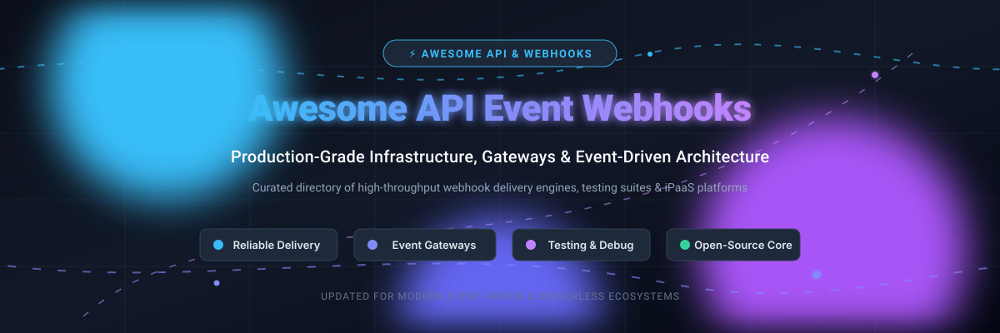

# ⚡ Awesome API Event Webhooks & Integration

  
  
  
  
  
  
  

  <strong>Curated directory of Outbound Webhook Infrastructure, Event Destinations, Webhook Gateways, Testing Suites &amp; Event-Driven Architecture (EDA) Integrations.</strong>

  🌟 <em>Star this repository if you find it helpful!</em> 🌟

---

## 📌 Overview

This repository tracks top-tier **SaaS platforms** and **open-source GitHub projects** in the **API Event Webhook & Event-Driven Integration** landscape. Whether you are seeking enterprise webhook delivery with HMAC signatures, exponential backoff retries, and customer-facing destination portals, or self-hosted cloud-native gateways for Kubernetes and serverless microservices, this guide provides actionable comparisons and clear distinctions between webhook delivery engines, testing suites, and iPaaS automation platforms.

### 🔍 Key Capabilities Covered:
- 🚀 **Outbound Webhook Delivery:** Reliable message dispatch, HMAC payload signing, retries, idempotency, and SLA enforcement.
- 🎯 **Event Destinations & Gateways:** Fanout routing to external targets including Amazon EventBridge, AWS SQS, Apache Kafka, GCP Pub/Sub, and RabbitMQ.
- 🧪 **Testing & Debugging Suites:** Ephemeral and local endpoints for payload inspection, request capturing, replay, and validation.
- 🔄 **Event-Driven iPaaS & Workflows:** Visual automation pipelines and code-based event orchestration connecting thousands of apps.

---

## 📑 Table of Contents

- [📊 Sector Overview & Market Dynamics](#-sector-overview--market-dynamics)
- [☁️ SaaS / Hosted Platforms](#️-saas--hosted-platforms)
- [🛠️ Open-Source GitHub Projects](#️-open-source-github-projects)
- [🤝 How to Contribute](#-how-to-contribute)
- [💖 Support](#-support)
- [📈 Star History](#-star-history)
- [⚖️ Disclaimer](#️-disclaimer)

---

## 📊 Sector Overview & Market Dynamics

The global market for **Integration Platform as a Service (iPaaS)** and **Event-Driven Architecture (EDA)** middleware is estimated between **$15B and $20B+**, expanding aggressively as real-time event streaming and automation become baseline requirements for cloud computing. 

The industry demonstrates a bifurcated structure: the enterprise event bus, cloud broker, and iPaaS tier is **moderately concentrated**—dominated by hyperscalers (AWS, Azure, Google Cloud) and established enterprise automation leaders—whereas the specialized **outbound webhook delivery infrastructure** and developer gateway space remains **highly fragmented**, fostering rapid open-source innovation, open-core startups, and niche developer toolkits.

---

## ☁️ SaaS / Hosted Platforms

| Company / Product | Category & Best For | Pricing (Starting Tier) | Free Tier / Trial Limits | Company Scale (Valuation / Revenue) |
| :--- | :--- | :--- | :--- | :--- |
| **[Amazon EventBridge](https://aws.amazon.com/eventbridge/)** | **Serverless event bus** for routing events between AWS services & SaaS apps. Best for AWS-centric scalable event routing. | **$1.00 / million custom events** (billed in 64 KB increments); $0.20 / million API Destination invocations | **Permanently Free**: Unlimited AWS service management events + 14M invocations/mo for EventBridge Scheduler + 5M ingested events/mo for Schema Discovery | **Parent Market Cap: ~$2.2T** (Amazon / AWS; AWS ARR >$105B) |
| **[HubSpot Webhooks](https://developers.hubspot.com/)** | **Native webhook subscriptions** for CRM events (contact created, deal updated). Best for reacting to CRM state changes. | **$0 / month** (included with Free CRM & Developer Portal); paid Hubs start at **$15/seat/month** | **Free Forever Plan**: 100 requests per 10 seconds burst limit, capped at 250,000 API requests/day | **Market Cap: ~$12B–$13.5B** (NYSE: HUBS; Revenue: ~$3.1B ARR) |
| **[Make](https://www.make.com/)** | **Visual automation platform** with 3,000+ app connectors. Best for visual flows and multi-step webhook triggers. | **$9 / month** billed annually ($10.59/mo monthly) for Core Plan (10,000 credits/mo) | **Free Forever Plan**: 1,000 operations/credits per month, 2 active scenarios, 15-minute minimum run interval | **Parent Valuation: ~$13B** (Celonis; Make subsidiary ARR estimated >$50M) |
| **[Zapier](https://zapier.com/)** | **No-code automation platform** with 7,000+ app integrations. Best for connecting apps without managing webhook infrastructure. | **$19.99 / month** billed annually ($29.99/mo monthly) for Professional Plan (750 tasks/mo) | **Free Forever Plan**: 100 tasks/month, 2-step single-trigger Zaps only, 15-minute polling interval | **Valuation: ~$5.0B** (Bootstrapped / secondary sale; Revenue: ~$310M ARR) |
| **[Segment](https://segment.com/)** | **Customer data platform (CDP)** routing events via webhooks & destinations. Best for collecting & syncing user event streams. | **$120 / month** for Team Plan (up to 10,000 Monthly Tracked Users) | **Free Forever Plan**: 1,000 Monthly Tracked Users (MTUs), 2 data sources, 1 data warehouse destination (daily sync) | **Acquisition Valuation: $3.2B** (Acquired by Twilio; Unit ARR >$150M) |
| **[Tray.io](https://tray.io/)** | **Enterprise automation platform** with advanced webhook triggers. Best for enterprise-grade low-code workflows. | **~$500–$700 / month** starting for Pro Plan (sales-led; median enterprise contract ~$37,600/year) | **14-day Free Trial** (or custom PoC) with starter task credit allotment; no permanent free tier | **Valuation: ~$600M** (Total venture funding: ~$160M) |
| **[Pipedream](https://pipedream.com/)** | **Developer-first automation platform** with code steps & webhook triggers. Best for code-level control over event workflows. | **$29 / month** for Basic Plan ($49/mo for Advanced) | **Free Forever Plan**: 100 credits/month (strict daily ceilings), 3 active workflows, 3 connected accounts, 300s execution limit | **Valuation: ~$70M–$100M est.** (Series A; Total funding: ~$22.4M; ARR: ~$5M) |
| **[Svix](https://www.svix.com/)** | **Webhooks-as-a-service platform** (managed cloud for open-source Svix). Best for turnkey outbound webhook infrastructure. | **$490 / month** for Pro Plan (includes 30-day trial and 50,000 messages/mo + $0.0008/msg) | **Free Forever Plan**: 50,000 messages/month, 50 messages/second rate limit, 99.9% uptime SLA | **Valuation: ~$40M–$60M est.** (Series A; Total funding: ~$13.1M; ARR: ~$1M–$5M) |
| **[Hookdeck](https://hookdeck.com/)** | **Event gateway & webhook infrastructure** (managed platform & Outpost). Best for reliable inbound/outbound event delivery. | **$39 / month** for Team Gateway Plan; Outpost outbound plans start at **$10 per million events** | **Free Forever Plan**: 10,000 events/requests per month, 3-day log retention, 5 events/second throughput | **Valuation: ~$15M–$25M est.** (Seed; Total funding: ~$3M; ARR: ~$1M est.) |
| **[Webhook.site](https://webhook.site/)** | **Webhook testing & debugging tool** with unique inspection endpoints. Best for inspecting payloads and testing integrations. | **$9 / month** ($90/year) for Basic Plan ($19/mo for Pro) | **Free Forever Plan**: 50 requests per instant URL, 50 requests history, URLs expire after 7 days | **Revenue: ~$400k ARR** (Bootstrapped / Micro-SaaS; traffic >700M reqs/day) |

---

## 🛠️ Open-Source GitHub Projects

Sorted by GitHub_Stars (descending):

1. ### 📦 [Trigger.dev](https://github.com/triggerdotdev/trigger.dev) 
   - **Description:** Open-source developer-first background jobs, durable workflows, and event-driven automation framework.
   - **Key Features:** Serverless background tasks, long-running processes, real-time webhook listeners with automatic retries and checkpointing.
   - **Tech Stack:** TypeScript, Node.js, PostgreSQL.
   - **Best For:** Developers wanting code-native background jobs triggered by webhooks without timeouts.

2. ### 📦 [webhook](https://github.com/adnanh/webhook) 
   - **Description:** Lightweight configurable incoming webhook server written in Go to execute shell commands and automation pipelines upon receiving HTTP payloads.
   - **Key Features:** Hook rule parsing, parameter passing to shell commands, secret token validation, lightweight standalone binary.
   - **Tech Stack:** Go.
   - **Best For:** Self-hosted CI/CD hooks, local server triggers, and infrastructure automation without heavy daemon overhead.

3. ### 📦 [Inngest](https://github.com/inngest/inngest) 
   - **Description:** Event-driven durable execution engine and serverless workflow platform for building reliable background step-functions.
   - **Key Features:** Webhook event ingestion, fanout, deduplication, step-level idempotency, zero-infrastructure concurrency control.
   - **Tech Stack:** Go, TypeScript.
   - **Best For:** Teams building complex event-driven pipelines, webhook ingestion handlers, and multi-step background tasks.

4. ### 📦 [CloudEvents Specification](https://github.com/cloudevents/spec) 
   - **Description:** Industry standard specification hosted by the CNCF for describing event data in a common, interoperable protocol format.
   - **Key Features:** Standard metadata headers, JSON / Avro / Protobuf mappings, HTTP / Kafka / Webhook protocol bindings.
   - **Tech Stack:** Specification / Multi-language SDKs.
   - **Best For:** Architectures requiring interoperable webhook payload definitions across diverse cloud and enterprise environments.

5. ### 📦 [Svix](https://github.com/svix/svix-webhooks) 
   - **Description:** Production-grade, enterprise-ready webhooks-as-a-service server powering commercial webhook infrastructure.
   - **Key Features:** Webhook subscription management, HMAC signing, exponential retries, event attempt logs, embeddable developer portal.
   - **Tech Stack:** Rust, PostgreSQL, Redis.
   - **Best For:** SaaS applications providing enterprise webhook delivery with customer self-service portals and SLA-grade reliability.

6. ### 📦 [Convoy](https://github.com/frain-dev/convoy) 
   - **Description:** High-performance cloud-native webhook gateway for bi-directional event ingress and egress.
   - **Key Features:** Event delivery retries, circuit breaking, rate limiting, request verification, end-to-end telemetry.
   - **Tech Stack:** Go, Redis, PostgreSQL.
   - **Best For:** Platform engineering teams requiring a Kubernetes-native webhook gateway capable of ingesting and delivering millions of events.

7. ### 📦 [Argo Events](https://github.com/argoproj/argo-events) 
   - **Description:** Event-driven workflow automation framework for Kubernetes, natively supporting webhooks as event sources.
   - **Key Features:** 20+ event sources (including generic webhooks, Kafka, AWS SNS/SQS, GitHub, Slack), event filtering, triggering Kubernetes objects & Argo Workflows.
   - **Tech Stack:** Go, Kubernetes CRDs.
   - **Best For:** Kubernetes-native organizations running cloud pipelines triggered by inbound webhooks and events.

8. ### 📦 [Knative Eventing](https://github.com/knative/eventing) 
   - **Description:** Cloud-native event routing and management system for building loosely coupled, event-driven serverless architectures on Kubernetes.
   - **Key Features:** CloudEvents-compliant routing, Channels, Brokers, Triggers, declarative subscription model for webhooks and stream consumers.
   - **Tech Stack:** Go, Kubernetes.
   - **Best For:** Large-scale serverless systems routing events across heterogeneous microservices and webhook sinks.

9. ### 📦 [Hookdeck Outpost](https://github.com/hookdeck/outpost) 
   - **Description:** Open-source outbound webhooks and event destination infrastructure designed to deliver events to customer endpoints.
   - **Key Features:** Multi-tenant support, customer-facing portals, topic subscriptions, delivery failure alerts, broad destination support (Webhooks, SQS, S3, Kafka, RabbitMQ, EventBridge).
   - **Tech Stack:** Go, PostgreSQL, Redis.
   - **Best For:** B2B platforms offering outbound webhook integrations and event fanout to enterprise customers.

10. ### 📦 [webhook-tester](https://github.com/tarampampam/webhook-tester) 
    - **Description:** Self-hosted open-source alternative to Webhook.site for testing and inspecting incoming HTTP webhooks in real time.
    - **Key Features:** Unique URL generation, customizable response codes/headers, built-in React web UI, WebSocket live streaming, ngrok tunnel integration.
    - **Tech Stack:** Go, React.
    - **Best For:** Developers and QA teams wanting an on-premise, secure webhook payload inspector for local testing and debugging.

11. ### 📦 [WebhookX](https://github.com/webhookx-io/webhookx) 
    - **Description:** Fast, modular open-source webhook gateway with extensible WASM plugin architecture.
    - **Key Features:** Declarative GitOps configuration, RESTful Admin API, fanout distribution, rate limiting, WebAssembly / JS transformation plugins.
    - **Tech Stack:** Go, Redis, PostgreSQL.
    - **Best For:** Teams wanting an extensible gateway with custom WASM transformations and declarative management.

12. ### 📦 [Relay](https://github.com/rajputomsingh/Relay) 
    - **Description:** Developer-friendly webhook delivery engine focused on strict at-least-once semantics and crash recovery.
    - **Key Features:** Idempotency-key enforcement, automatic retry classification (4xx vs 5xx), failure replay, lease fencing for crashed workers.
    - **Tech Stack:** Go, MongoDB.
    - **Best For:** Developers wanting a straightforward, lightweight delivery service with clear idempotency guarantees.

---

## 🤝 How to Contribute

Contributions are warmly welcomed! Help keep this directory accurate, up-to-date, and valuable for the community.

1. 🍴 **Fork the repository** on GitHub.
2. 🌿 **Create a new branch** (`git checkout -b feature/add-new-webhook-tool`).
3. 📝 **Add your project** in the appropriate section maintaining the existing format:
   - Name and direct project link
   - Badge with social Stars_Count (`https://img.shields.io/github/stars/owner/repo?style=social&color=white`) linking to its stargazers page
   - Concise factual description, key features, tech stack, and primary use case
4. 🧪 **Ensure links and formatting are valid**.
5. 🚀 **Submit a Pull Request** with a brief summary of what you added!

---

## 💖 Support

If you find this repository helpful, consider supporting its maintenance and continued expansion:

- 🌟 **Star the repository** to boost discoverability on GitHub!
- 🍴 **Fork and share** with colleagues and developers in your network.
- 💬 **Join the conversation** on [Discord](https://discord.gg/jc4xtF58Ve) to discuss webhook architecture and event-driven patterns.
- ☕ **Buy me a coffee / Sponsor**: If you'd like to support ongoing open-source curation and development, check out the [GitHub Sponsor Dashboard](https://github.com/sponsors/ishandutta2007). Thank you for your support! 🚀

---

##  Star History

---

## ⚖️ Disclaimer

- This is a **community-curated directory** created for educational and informational purposes; inclusion does not constitute an endorsement.
- **Architectural Clarification:**
  - **Webhook Delivery Infrastructure** (*Svix, Convoy, WebhookX, Relay*) delivers outbound events with signing, retry scheduling, and telemetry.
  - **Event Destination Platforms** (*Hookdeck Outpost*) manage outbound multi-tenant destinations across webhooks, cloud queues, and streaming brokers.
  - **Testing & Debugging Tools** (*webhook-tester, Webhook.site*) capture and inspect payloads during development and CI/CD pipelines.
  - **Integration & Workflow Platforms** (*Zapier, Make, Segment, Pipedream, Tray.io*) execute complex multi-app orchestration, data normalization, and ETL flows.
- **Security & Compliance:** Webhook endpoints frequently process sensitive business data. Always enforce cryptographic signature verification (e.g., HMAC-SHA256), replay protection with timestamps, and TLS/HTTPS transport security before exposing endpoints to production traffic.

---

  Maintained by <a href="https://github.com/ishandutta2007">Ishan Dutta</a> and the global open-source community.

